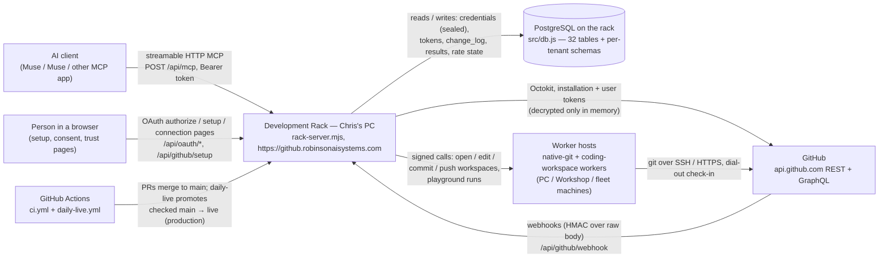

# Relational map — GitHub Unleashed (github-mcp)

How the whole system connects, in plain readable form. This is the map;
`docs/ARCHITECTURE.md` is the detailed runtime-facts record, and
`docs/TOOL-CATALOG.md` is the per-tool catalogue. If this map and the code
disagree, the code wins and the map is fixed in the same change (see
`docs/RULES.md`).

Last surveyed: 2026-11-18, from `main` (clone of the public repo).
Catalogue count (checked in CI against the code by `scripts/check-map-counts.mjs`,
see `counts.json`): `scripts/count-catalog.py` reports 519 tools
(513 hand-built + 6 universal) in 45 sections; the home page / README
profile counts are Read-only 215, Everyday 306, Full 518 visible tools —
visibility is narrower than the catalogue because profiles hide tools.

## The system in one picture

## Node-and-wire list (the same picture, as text)

- **AI client —calls→ MCP endpoint** (`api/mcp.js`): streamable-HTTP MCP.
  Auth is a bearer token checked in `src/core/mcp-auth.js`; no bearer, no
  store is even opened.
- **MCP endpoint —serves→ registry + dispatch** (`src/core/mcp-server.js`,
  `src/tools/index.js`, `src/tools/dispatch.js`): `tools/list` is filtered
  by the connection's profile and listing; `tools/call` goes to the
  dispatcher, which is default-deny.
- **Dispatcher —calls→ GitHub backend** (`src/github/client.js`): Octokit
  (core + paginate + throttling + retry + auth-app) against GitHub REST
  and GraphQL. Every result is shaped, redacted and budgeted on the way
  back (see `github-backend-and-safety.md`).
- **OAuth server —issues→ MCP tokens** (`api/oauth/*`, `src/core/oauth*.js`,
  `src/oauth/*`): dynamic registration, authorize, token, revoke, PKCE,
  plus `/.well-known/oauth-authorization-server` and
  `/.well-known/oauth-protected-resource` discovery.
- **GitHub App setup —creates→ stored accounts** (`api/github/[action].js`,
  `src/github/app-manifest.js`, `src/github/credentials.js`): a person
  creates/installs a GitHub App per account; its secrets are sealed with
  AES-256-GCM (`src/core/crypto.js`, `TOKEN_ENCRYPTION_KEY`) into
  `gh_apps` / `gh_accounts` in PostgreSQL.
- **Tenancy —isolates→ public and private users** (`src/tenancy/*`): each
  tenant gets its own PostgreSQL schema (`gh_t_<32 hex>`); tenant bearer
  tokens never fall back to the owner database.
- **Native-git workspaces —delegate→ worker hosts** (`src/native-git/*`,
  `workers/native-git/`): clone/edit/commit/push happens on a worker in
  the pool, chosen once and pinned to that workspace for life.
- **Playground / coding workspaces —delegate→ device hosts**
  (`src/playground/*`, `workers/coding-workspace/`, `src/fleet/*`):
  dial-out fleet agents check in, receive signed orders, and run
  previews/runtimes on the person's own machines.
- **Middleware —guards→ byte streams** (`middleware.js`): only
  `/v1/transfer/*` and `/git/*` (the git remote) pass through it; bodies
  are never consumed there, they stream to the worker/broker.
- **Release —promotes→ production**: PRs land on `main`; the
  `daily-live` workflow fast-forwards a checked `main` snapshot to
  `live`; the rack serves `live`. See `hosting-and-release.md`.

## Files in this map

| File | Area |
|---|---|
| [mcp-and-tools.md](mcp-and-tools.md) | MCP endpoint, registry, meta-tools, workflow tools, dispatch, result shaping |
| [auth-tenancy-and-storage.md](auth-tenancy-and-storage.md) | OAuth server, GitHub App connection flow, token encryption, PostgreSQL, tenancy |
| [github-backend-and-safety.md](github-backend-and-safety.md) | Octokit backend, rate limiting, log summaries, guards, scanning, webhooks |
| [workspaces-playground-and-fleet.md](workspaces-playground-and-fleet.md) | Native-git workspaces, git remote, playground/coding workspaces, fleet agents, Marketplace |
| [hosting-and-release.md](hosting-and-release.md) | Rack entrypoint, retired Vercel shape, CI, daily-live promotion, workers' deployment |

## Reading order for a new agent

1. This file.
2. The area file for whatever you are about to change.
3. `docs/ARCHITECTURE.md` for the exact runtime facts of that area,
   then the code itself.
