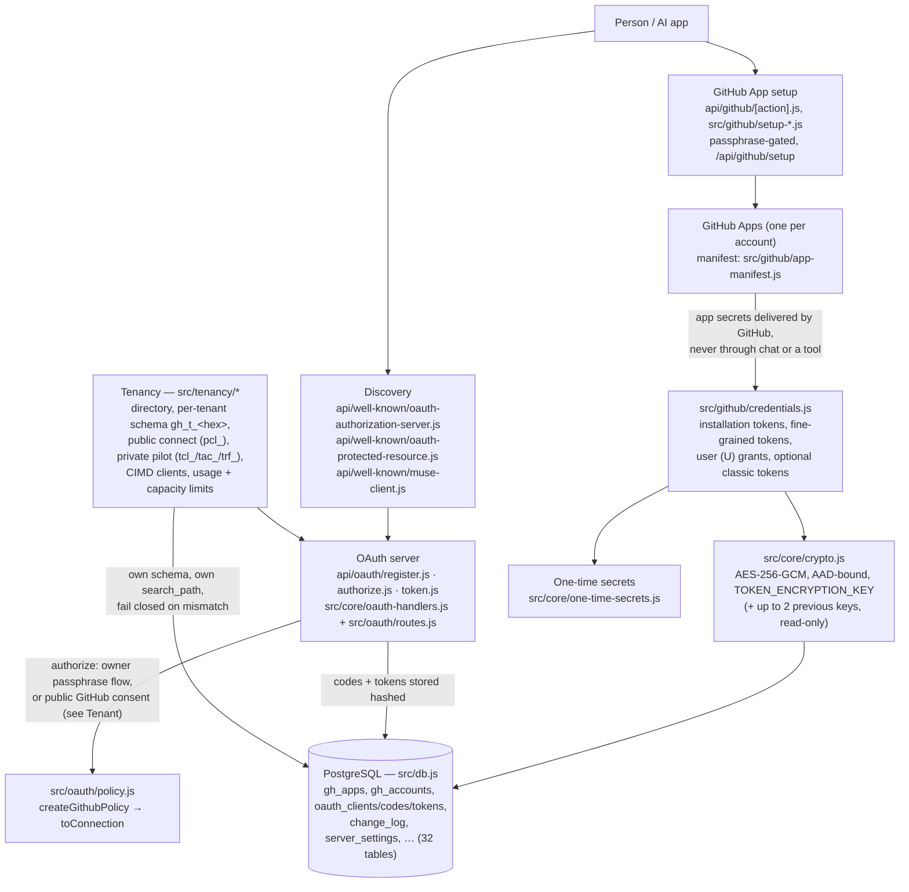

# Auth, connection flow, tenancy and storage

## Wires, in words

- **Two sign-in worlds, one door.** The standard MCP OAuth flow serves
  the owner/operator connection. When public connect is enabled
  (`GITHUB_PUBLIC_CONNECT=enabled`, `src/tenancy/public-connect.js`),
  registration creates public clients (`pcl_…`) and authorize routes to
  a GitHub consent flow where each person signs in with their own
  GitHub — no `ADMIN_PASSPHRASE` is exposed. The older private-tenant
  pilot (`tcl_`/`tac_`/`trf_` routed credentials) keeps existing
  connections working but takes no new sign-ins once public connect is
  on. CIMD (client-ID-metadata-document) clients are a third recognised
  client shape (`src/tenancy/cimd-client.js`); the public Muse client
  also answers to the nickname `muse`.
- **Connection = profile + account + credential.** `toConnection` (from
  `src/oauth/policy.js`) turns a verified token into the connection the
  dispatcher sees: client, pass, profile (`read_only` / `everyday` /
  `full`), listing, time zone, and which GitHub account it may act on.
  Service passes handed to other agents keep the limits their issuer
  chose (`src/rtc/*` pass scopes and grants).
- **GitHub credentials.** Per account, one of: a GitHub App installation
  (App JWT → short-lived installation token, downscoped to the
  connection profile for read-only), a fine-grained personal token, or
  a user-to-server (U) grant for the few person-only actions. Optional
  classic tokens exist only for notifications and packages, set up on
  the setup page, never through a tool. Credential derivation and
  authority proofs live in `src/github/credentials.js`,
  `credential-derivation.js`, `credential-authority.js`, `act-as.js`.
- **Encryption.** Everything secret at rest is sealed by
  `src/core/crypto.js`: AES-256-GCM, random 12-byte IV, AAD bound to the
  record's context (service / account / tenant / identity), envelope
  format `v1.<iv>.<tag>.<ciphertext>`. Bearer tokens themselves are
  stored as SHA-256 hashes (`hashToken` in `src/core/oauth.js`). Login
  lockout: 5 failed passphrase attempts per client IP per 15 minutes
  (`login_attempts`).
- **Storage.** `src/db.js` creates 32 tables additively
  (`CREATE TABLE IF NOT EXISTS`): `gh_apps`, `gh_app_previous_secrets`,
  `gh_accounts`, `gh_installation_tokens`, `setup_states`,
  `oauth_clients`, `oauth_codes`, `oauth_tokens`, `login_attempts`,
  `change_log`, `gh_write_batches`, `one_time_secrets`,
  `gh_rate_state`, `gh_write_slots`, `gh_etag_cache`,
  `server_settings`, `protected_resources`, `known_projects`,
  `result_store`, `gh_async_jobs`, `secret_entry_requests`, the
  `dev_*` scenario tables, `git_remote_keys` / `git_remote_uses`, and
  the `rtc_pass_*` tables. `src/db-transport.js` supplies the store
  factory; on the rack the database is PostgreSQL on the same rack
  (the Neon serverless driver shape is retained from the Vercel era).
- **Tenancy isolation.** `src/tenancy/directory.js` is a separate
  identity/tenant/membership registry (GitHub numeric subject, opaque
  tenant UUID, owner/admin/member roles, membership epochs). Each
  tenant's ordinary tables live in its own schema, selected per
  connection via `search_path`; a missing, malformed or mismatched
  schema fails closed and never falls back to the owner's data.
  Capacity (`src/tenancy/runtime-limits.js`) and public fair-use
  counters (`src/tenancy/public-usage.js`: free calls/day, writes/hour,
  cost pause, inactivity cleanup) are enforced per tenant.
