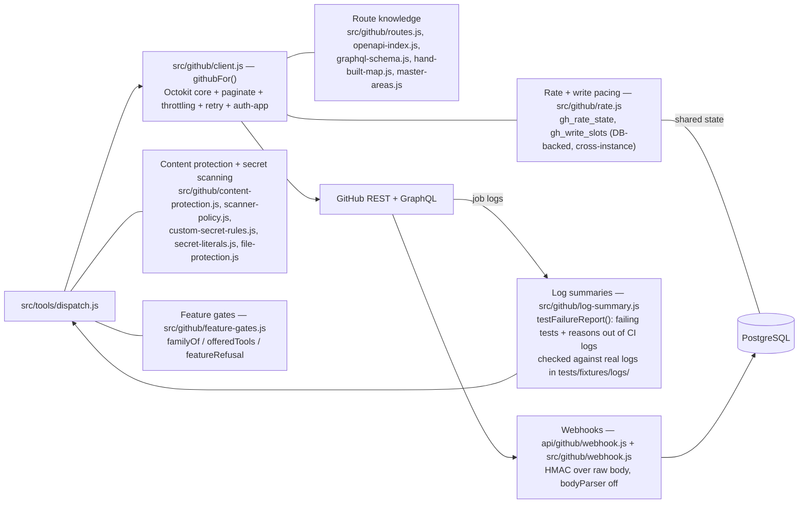

# GitHub backend, rate limiting, summaries and safety

## Wires, in words

- **One backend.** All tool handlers reach GitHub through
  `githubFor()` in `src/github/client.js` — there is no second HTTP
  path. It builds an Octokit client per credential kind (App
  installation token, fine-grained token, user grant) with pagination,
  throttling and retry plugins, and translates failures via
  `src/github/errors.js`.
- **Route knowledge.** Which REST/GraphQL operation a tool means is
  pinned in code, not guessed at call time: `routes.js`,
  `openapi-index.js` (the indexed GitHub OpenAPI surface),
  `graphql-schema.js` / `graphql-writes.js`, `hand-built-map.js` and
  `master-areas.js`. The universal tools resolve arbitrary operations
  against the same index.
- **Rate limiting, shared across instances.** `src/github/rate.js`
  keeps three jobs in PostgreSQL so every server process sees the same
  truth: (1) write spacing — at most one write per second per
  installation, claimed atomically (`gh_write_slots`); (2) remembered
  rate headers per account + resource bucket (core / search /
  code_search / graphql) in `gh_rate_state`; (3) refusal while a bucket
  is blocked, with the reset time rendered in Denver time. An ETag
  cache (`gh_etag_cache`) trims repeat reads.
- **Log summaries.** CI and Actions tools do not dump raw logs by
  default: `src/github/log-summary.js` extracts the failing tests and
  their reasons (runner-aware markers for vitest/jest, dotnet, pytest,
  go, and others), merges them across every log text of a job, caps the
  list with an honest count (`tests_failing`, `tests_cut`), and redacts
  before return; the markers are checked against real runner logs kept
  verbatim in `tests/fixtures/logs/`; the full log
  stays available behind the result handle / `fullText` routes. This
  powers `github_workflow_ci_failure_summary` and the job-log tools.
- **Webhooks in.** GitHub App webhooks land on
  `api/github/webhook.js` with the raw body preserved (HMAC verified
  over the exact bytes; the rack entrypoint and Vercel config both keep
  this route unparsed). Marketplace webhooks have their own receiver
  (`api/marketplace/webhook.js`).
- **Safety layer.** Content protection (`content-protection.js`,
  `file-protection.js`) guards protected paths and resources;
  secret scanning (`scanner-policy.js`, `custom-secret-rules.js`,
  `open-secret-rules.js`, `secret-literals.js`, `secret-seal.js`) runs
  over content the server writes, and shaped results have
  credential-shaped text withheld even after redaction. Push refusals
  and placeholder guards (`push-refusals.js`, `placeholder-guard.js`)
  stop known-bad writes before they reach GitHub. Spend, production
  and plan limits are classified in `spend-classes.js`,
  `plan-limit.js`, `prices.js` and enforced by the dispatch gates.
- **Feature gates.** `feature-gates.js` asks what the account actually
  has (Copilot, merge queue, hosted runners, …) and hides/refuses the
  rest with a plain reason, instead of letting GitHub 404s speak.
