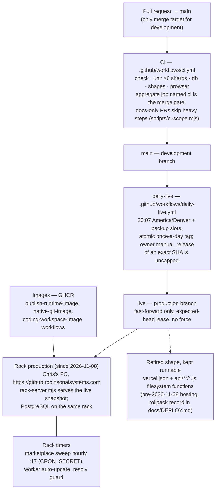

# Hosting, entrypoints and release

## Wires, in words

- **One server, two shells.** The application is the `api/**/*.js`
  handlers plus `src/**`. On the rack, `rack-server.mjs` is a thin
  standalone Node 24 server that reproduces the Vercel contract route
  for route: filesystem binding of `api/` files (bracket segments as
  query params), the 21 `vercel.json` rewrites, the middleware
  families for `/v1/transfer/*` and `/git/*` streamed through a proxy
  hop, raw bodies only for the two HMAC webhook receivers, the 4.5 MB
  body limit elsewhere, and the release commit pinned from
  `RACK_RELEASE_COMMIT` / `release-commit.txt`. No application logic
  lives in the entrypoint. `rack-init-store.mjs` prepares the store.
  The Vercel project shape is retained so the same tree still deploys
  there; production has run on the rack since 2026-11-08.
- **Front door.** `api/index.js` serves `/`: JSON service facts for
  programs (name, tool counts by profile, deployed SHA) and the HTML
  home page (`src/brand/home-page.js`) for browsers. Brand assets are
  served through the same function (`?brand_icon=`).
- **HTTP surface besides MCP.** `/api/oauth/*` (register, authorize,
  token), `/api/tenant/oauth/*`, `/api/github/[action]` (setup and
  account actions) + `/api/github/webhook`, `/api/tools/[name]` and
  `/api/tools` (direct tool HTTP), `/api/results/[handle]`,
  `/api/marketplace/*`, `/api/playground/*` (enroll, lifecycle,
  preview, sweep), `/api/fleet/*` (checkin, report, agent-bundle),
  `/api/git-remote`, `/api/native-git-key`, `/api/openapi`
  (`/api/openapi.json`), `/api/whoami`, `/.well-known/*`,
  `/api/security-txt`. Every one of these is dispatched by
  `rack-server.mjs` to the same module Vercel would invoke.
- **CI.** `.github/workflows/ci.yml` runs on PRs and pushes to `main`
  with a read-only token and no secrets: `check` (secret scan, docs
  check, catalogue count, lint, write-safety, token budgets), `unit`
  in 6 shards, `db` against disposable PostgreSQL 17, `shapes`, and
  browser shards; the aggregate job named `ci` is the single merge
  gate. Housekeeping workflows prune merged branches, publish the
  runtime / native-git / coding-workspace images, and keep git
  hygiene.
- **Release.** `.github/RELEASE-POLICY.md` is the authority:
  development merges only to `main`; `daily-live.yml` alone promotes
  `main` → `live`, scheduled 20:07 America/Denver with backup slots
  (20:23, 21:23, 01:43 Denver, 08:49 UTC) sharing one atomic
  once-per-Denver-day tag, refusing on failed/pending checks or
  diverged history, fast-forward only. An owner-dispatched
  `manual_release` / `owner_release` of an exact green SHA is allowed
  any number of times, receipted per SHA. Never open a PR whose head
  is `live` (the repo deletes source branches after merge).
- **Cron equivalents.** Vercel's hourly marketplace sweep becomes the
  rack systemd timer `rack-github-sweep.timer` calling the same route
  with the same `CRON_SECRET` bearer the handler checks.
