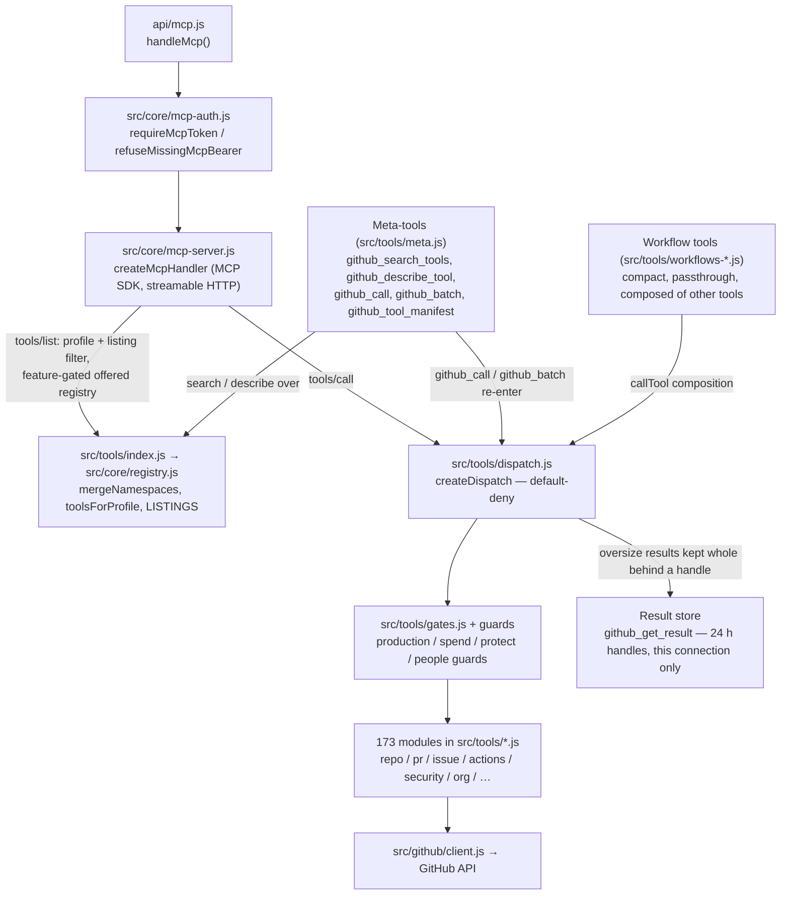

# MCP endpoint and the tool catalogue

## Wires, in words

- **Entry.** `api/mcp.js` is the only MCP door. It branches first on the
  bearer: private-tenant tokens (`src/tenancy/mcp-route.js`) are resolved
  against that tenant's schema and never retried against the owner DB;
  Marketplace calls arrive with a `marketplaceAccountId`; the operator's
  own route is the only one marked as operator (`operatorConnection` in
  `src/core/authority.js`), which is what makes operator-only tools exist.
- **Listing.** A connection has a profile — `read_only`, `everyday` or
  `full` (`src/core/registry.js` `toolsForProfile`). `tools/list` shows
  either the `catalog` listing (everything the profile may see) or the
  `compact` listing (only tools marked `compact`: the meta-tools, whoami
  and the workflow tools). A feature gate (`src/github/feature-gates.js`
  `offeredRegistry`) can further hide families an account does not have
  (Copilot, merge queue, hosted runners). Hidden ≠ callable: dispatch
  re-checks visibility by name.
- **The catalogue.** `src/tools/index.js` merges 173 modules with
  `mergeNamespaces` (duplicate or handler-less names throw at startup).
  Areas (by `area:` tag, largest first): repo, server, actions, pr,
  issue, security, enterprise, user, git, copilot, content, review,
  project, org, dev, release, env, branch, meta, commit, check, secret,
  pages, package, deploy, artifact, account, wiki, variable, tag,
  playground, job, and singletons. Six universal tools
  (`src/tools/universal.js`, `universal-graphql.js`) call GitHub REST /
  GraphQL operations directly by name.
- **Meta-tools — the gateway.** `github_search_tools` (find by words),
  `github_describe_tool` (full schema + whether it is direct or only via
  `github_call`), `github_call` (run any tool the profile allows, through
  the same dispatcher), `github_batch` (up to 10 reads in one call;
  writes are refused), `github_tool_manifest`. In the compact listing
  these five are how an agent reaches all the other tools.
- **Workflow tools — composed, not new plumbing.** Files
  `workflows-pr.js`, `workflows-merge.js`, `workflows-ci.js`,
  `workflows-find.js`, `workflows-health.js`, `workflows-review.js`,
  `workflows-release.js`, `workflows-write-batch.js` compose underlying
  tools via `ctx.callTool`: e.g. `github_workflow_pr_status`,
  `github_workflow_open_pr`, `github_workflow_merge_when_green` /
  `merge_stack` / `merge_anyway`, `github_workflow_ci_failure_summary`,
  `github_workflow_repo_health`, `github_workflow_new_repo`,
  `github_workflow_release`. They add judgement and sequencing, never a
  second path around the dispatcher's guards.
- **Dispatch.** `src/tools/dispatch.js` validates arguments against the
  tool's own schema (`src/core/validate.js`), runs read tools directly,
  and write tools through the ordered gates (`src/tools/gates.js`:
  profile, account scope, production/spend/protection guards, change
  log). Results pass through `shapeResult` (`src/tools/util.js`):
  credential-shaped fields become `[hidden]`, times gain a `_local`
  twin in the person's saved time zone, whole cents gain `_display`,
  content from non-trusted authors is marked `untrusted: true`, and a
  production connection's results carry a `PRODUCTION` banner.
- **Big results.** Anything cut by the text/size budget is kept whole in
  the result store (`result_store` table, `api/results/[handle].js`)
  behind a 24-hour, connection-scoped handle; the reply names the exact
  `github_get_result` continuation call.
  Every list reply carries `returned_count` next to `count`; when the
  limit cut the list it also says `all_returned: false` with a
  `returned_note` naming the next call (`withReturnedCount`,
  RETURNED-COUNT-1). A list whose single row is too big shows that row
  with its largest fields named in `_left_out` instead of an empty list
  (`fitToBudget`, FULL-ROWS-1); a list too big to keep whole is kept up
  to the rows that fit (`kept_rows`/`of_rows`, KEEP-PART-1).
  `github_call` and `github_batch` take a tool's arguments as `args`
  or `arguments` (CALL-ARGS-1).
- **Errors.** `src/tools/errors.js` renders GitHub failures as what
  happened / likely cause / what to do / one technical line with the
  GitHub request id.
