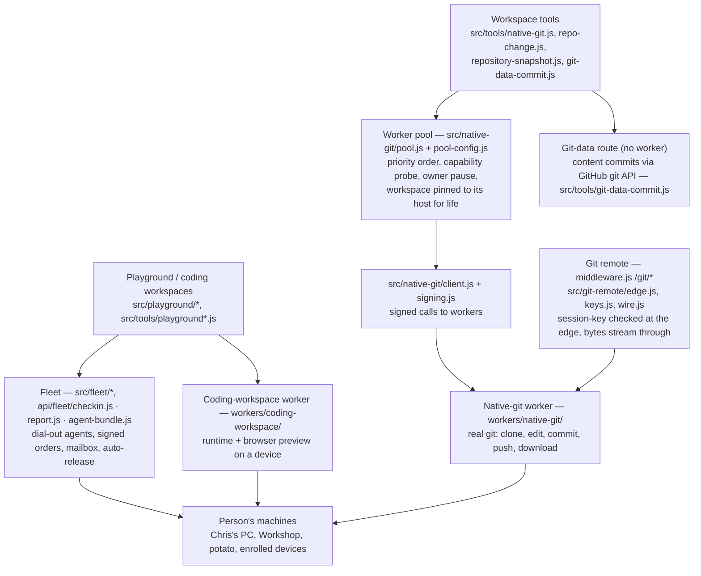

# Workspaces, git remote, playground and fleet

## Wires, in words

- **Two ways to change a repo.** (1) The **git-data route** builds
  commits through GitHub's git API from file snapshots — no clone, no
  worker; it is what snapshot pushes use. (2) **Native-git workspaces**
  are real clones on a worker host: open, read/write files, run git
  operations, commit and push with real ancestry. Tool entry points:
  `src/tools/native-git.js` (workspace open/read/write/commit/push),
  `repo-change.js`, `branches.js`, `git-remote.js`.
- **The pool.** `src/native-git/pool.js` tries configured hosts in
  priority order: enabled, answers its signed capabilities call, not
  paused by its owner, admits work by measured resources, under its
  workspace limit. The chosen host id is recorded on the workspace's
  job — every later call stays on that host; there is no live
  migration. No host available = a plain, retryable refusal before
  anything is cloned. Status answers are cached ~20 s per process.
- **The worker.** `workers/native-git/` is a standalone service
  (its own Dockerfile/compose): git engine, egress guard, safe-file
  rules, SSH to GitHub with per-workspace deploy keys
  (`src/git-remote/deploy-keys.js`, `git_remote_keys` table). Calls
  from the server are body-signed (`src/native-git/signing.js`).
- **The git remote.** `https://github.robinsonaisystems.com/git/<owner>/<repo>.git`
  lets a plain git client use the server as a remote: `middleware.js`
  matches `/git/*`, `src/git-remote/edge.js` checks the one-time
  session key, and the pack bytes stream (never buffered) to the
  worker/broker. One-time transfers use the sibling `/v1/transfer/*`
  family (`src/native-git/relay.js`).
- **Playground / coding workspaces.** `src/playground/*` allocates a
  runtime for a repo on an enrolled host or a person's device: sizing,
  prebuilt images (GHCR `github-mcp-runtime`), attachment of the repo,
  preview entry, lifecycle and a sweep (`api/playground/sweep.js`) that
  advances or disposes stuck allocations (rows left from the retired
  Dokploy pool are closed in place and reported as a manual teardown,
  `retired_pool`). The coding-workspace worker
  (`workers/coding-workspace/`) serves the runtime and browser preview
  on the device itself.
- **Fleet.** Hosts that cannot be reached inbound dial out:
  `api/fleet/checkin.js` / `report.js` receive signed check-ins and
  reports (`src/fleet/protocol.js`, `host.js`), orders wait in a
  DB mailbox (`src/fleet/mailbox.js`, `relay.js`), and agent updates
  are advertised as signed bundles (`src/fleet/agent-release.js`,
  `api/fleet/agent-bundle.js`) — the agent verifies the signature and
  bundle hash and refuses downgrades itself. PC deployment helpers
  live in `deploy/pc/` (compose, install, auto-update + resolv-guard
  systemd timers).
- **Developer scenarios.** `src/dev/*` + `src/tools/dev-*.js` run
  journalled scratch-repo scenarios (birth labels, forwarders, cleanup
  executions in the `dev_*` tables) so risky flows are proven on
  scratch organisations first; `src/developer/*` +
  `api/developer/connect.js` handle developer handoffs.
- **Marketplace.** `src/marketplace/*` + `api/marketplace/mcp.js`
  serve the same MCP surface to Marketplace accounts, with its own
  resource, lifecycle, sweep (hourly, `:17`) and webhook receiver.
- **RTC passes.** `src/rtc/*` issues scoped, rate-limited passes so one
  agent can hand another a bounded slice of this server's authority;
  `api/contract.js` and `src/rtc/openapi.js` publish the contract.
